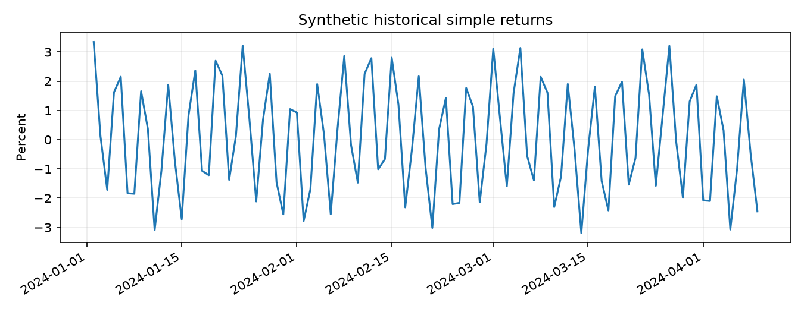
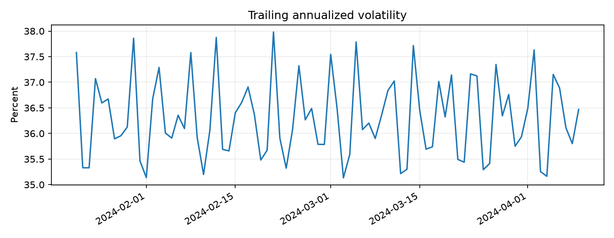
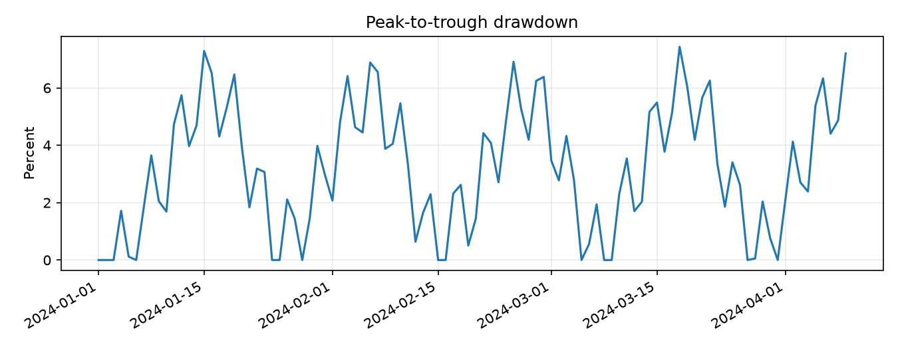

# C++ Quantitative Risk Analytics

[](https://github.com/santiago-pascual/cpp-quant-risk-dashboard/actions/workflows/ci.yml)

Dependency-free C++17 command-line engine for single-asset historical return and risk analysis, with independent NumPy/pandas numerical verification. Project 02/30 — Quantitative Finance Programming Series.

## Features

- Chronological CSV ingestion with Gregorian date validation, positive finite prices, duplicate rejection and field-count checks.
- Simple/log returns, arithmetic/geometric growth, sample variance, volatility, calendar CAGR and observation-based annualization.
- Sharpe, Sortino, maximum drawdown, rolling volatility, historical VaR and expected shortfall.
- Configurable CLI, interactive file prompt, per-observation CSV export and explicit N/A values.
- CMake/CTest, compiler warnings and automated Python reference validation.

## Build and run

Requires a C++17 compiler and CMake 3.16+. Python is optional for running the independent validation.

```sh
cmake -S . -B build -DCMAKE_BUILD_TYPE=Release
cmake --build build --config Release
ctest --test-dir build -C Release --output-on-failure
./build/dashboard data/synthetic_prices.csv --periods 365 --rf 0.03 --confidence 0.95 --window 20 --export results.csv
```

On Windows with Visual Studio generators use `build/Release/dashboard.exe`; with single-configuration generators use `build/dashboard.exe`. Run without arguments for an interactive file prompt. `--help` lists options. Defaults: 252 periods/year, zero annual risk-free rate, 0.95 confidence, 20-return rolling window. Rates are decimal fractions. Export contains dates, prices, simple/log returns, drawdown and rolling annualized volatility; scalar metrics are printed as key=value.

Input headers: `Date` and `Close` or `Close/Last`, in any column order. Extra columns are ignored after field-count validation. Dates use YYYY-MM-DD or US M/D/YYYY; optional dollar prefix, quoted single-line fields and UTF-8 BOM are supported. Ascending, descending and unsorted observations are sorted. Blank/malformed rows are rejected. Example:

```csv
Date,Close
2024-01-01,100
2024-01-02,101
```

## Methodology

See [complete formulas, conventions and undefined cases](docs/methodology.md). Returns use consecutive observations; sample variance uses N-1. Calendar CAGR uses elapsed days / 365.2425, independently of observation-based geometric annualization. Risk ratios use an effective annual risk-free rate converted to a periodic rate. Historical ES uses fractional empirical tail weighting.

## Independent numerical validation

```sh
python -m pip install numpy pandas matplotlib
python scripts/validate.py build/dashboard --figures
```

Use the appropriate executable path on Windows. The script independently computes all 15 scalar metrics and five exported series, comparing with relative tolerance 1e-10 and absolute tolerance 1e-12. Verified locally using GNU C++ 14.2.0, Release build: CTest 1/1 passed; synthetic dataset (100 prices) and original Nasdaq-style dataset (23 prices) both passed. The automated build, CTest suite and numerical validation have passed on GitHub Actions.

Synthetic example: 100 daily observations, 365 periods/year, 3% annual risk-free rate, 95% confidence, 20-return window. Rates below are decimal fractions.

| Metric | C++ | Python |
|---|---:|---:|
| mean_simple | 0.0006523348211 | 0.0006523348211 |
| mean_log | 0.0004779499225 | 0.0004779499225 |
| geometric_return | 0.0004780641587 | 0.0004780641587 |
| sample_variance | 0.0003523428488 | 0.0003523428488 |
| volatility | 0.01877079777 | 0.01877079777 |
| annual_volatility | 0.3586155878 | 0.3586155878 |
| annual_arithmetic | 0.2381022097 | 0.2381022097 |
| annual_geometric | 0.1905932612 | 0.1905932612 |
| calendar_cagr | 0.1907312623 | 0.1907312623 |
| sharpe | 0.5815202061 | 0.5815202061 |
| sortino | 0.8526273925 | 0.8526273925 |
| downside_deviation | 0.01280230765 | 0.01280230765 |
| max_drawdown | 0.0743208242 | 0.0743208242 |
| var | 0.0278181843 | 0.0278181843 |
| es | 0.03035710126 | 0.03035710126 |

## Visual evidence

Figures generated by the validation script from the deterministic synthetic price series, independently checked against C++ exports. These are not real-market performance claims.





## Repository structure

```text
include/risk/      Public analytics and ingestion interfaces
src/               CLI, analytics and CSV implementations
tests/             Mathematical and ingestion checks
data/              Deterministic synthetic dataset
scripts/           Independent validation and figure generation
docs/              Statistical methodology
figures/           Reproducible example charts
.github/workflows/ Automated build and validation
```

The original historical Nasdaq-style dataset is not distributed because its redistribution rights have not been established. The deterministic synthetic dataset is included for reproducible validation. Users may optionally supply their own appropriately licensed historical data.

## Limitations

Single asset, closing prices only; no portfolio covariance, transaction costs, dividends, splits, missing-session detection or intraday risk. CSV support excludes multiline quoted records. Extra data columns are not semantically validated. Rolling volatility uses a direct window calculation. Historical tail statistics are sensitive to sample size. Annualization assumes comparable observation intervals; calendar CAGR is distinct. Educational/research software, not investment advice.


## Optional historical-data validation

To validate against a separately obtained and appropriately licensed historical dataset:

    python scripts/validate.py build/dashboard --historical /path/to/prices.csv

The synthetic dataset remains the mandatory validation benchmark used by CI.

## License

The original software is released under the [MIT License](LICENSE).
This license does not grant redistribution rights to third-party market data.
